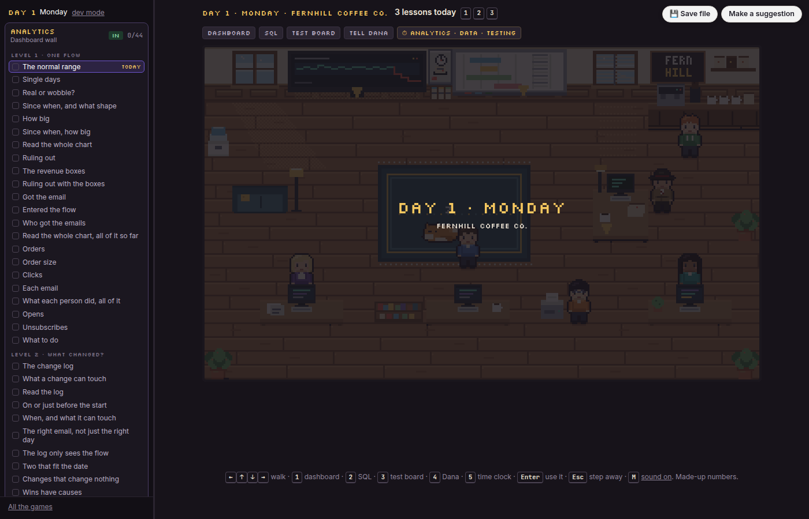
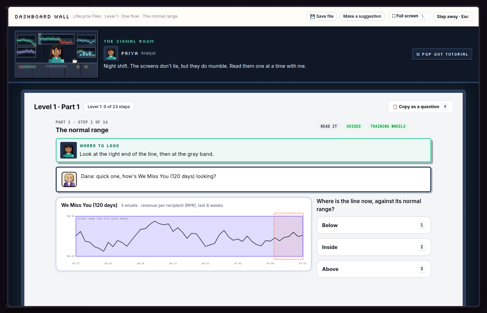
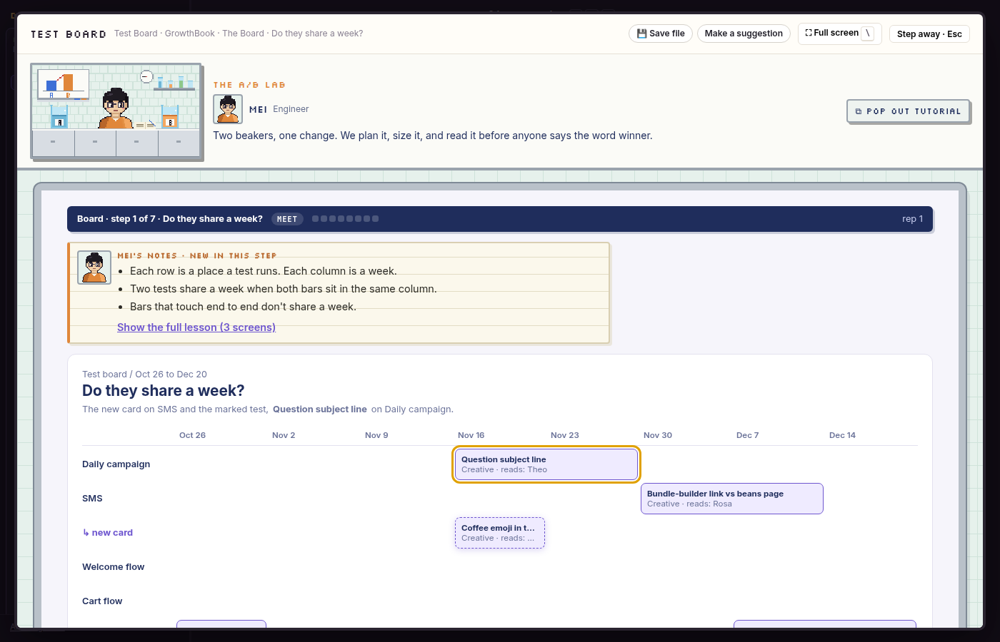
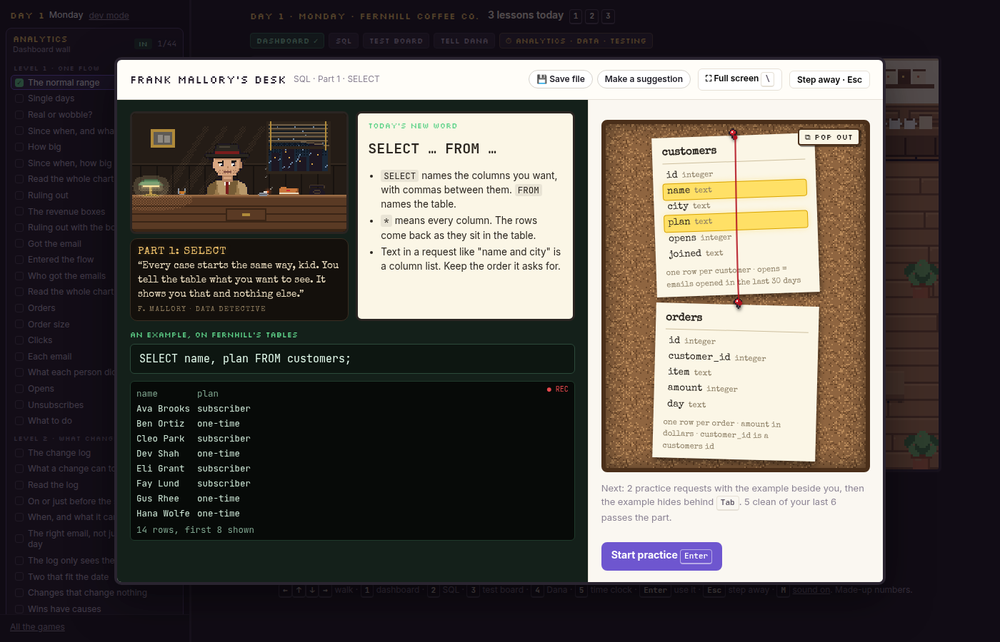
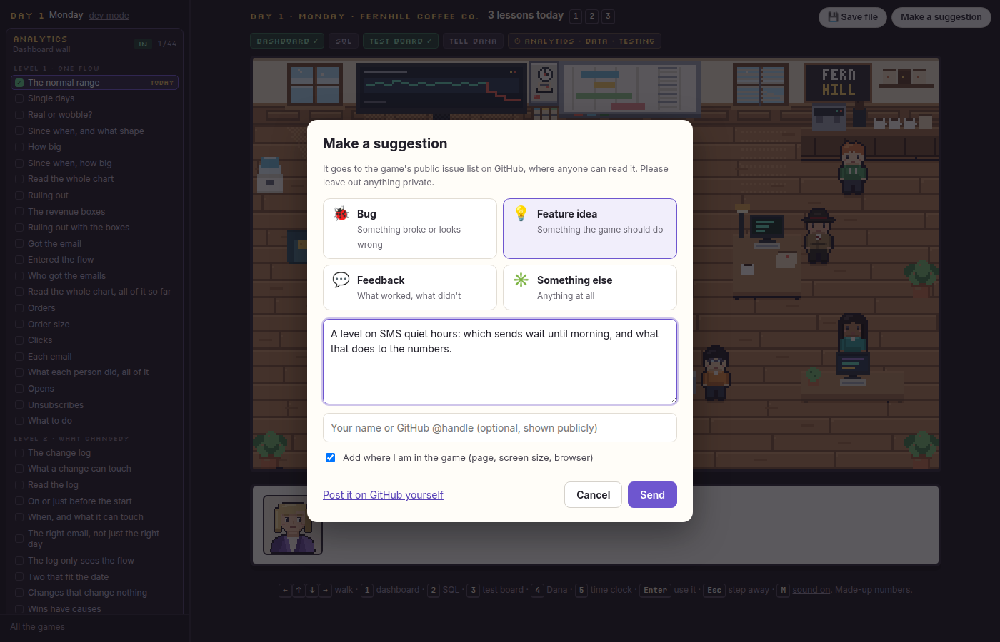

# Lifecycle Practice

Free practice games for lifecycle and email marketers. You learn the judgment calls of the job by making them, on
screens built like the tools you'd use at work: a flow dashboard, a SQL console and an A/B testing tool.

**Play it:** https://lifecycle-practice.vercel.app (no account, nothing to install)



**Help build it.** The best levels come from people who do the job. Tell me a story from work, send an idea, or build a
level yourself. [Here's how](https://lifecycle-practice.vercel.app/contribute/).

## What's in it

You've just started at **Fernhill Coffee Co.**, a made-up coffee brand. On day 1, Dana asks what you were hired for.
Pick one role, two or all three. Each workday, every desk you're clocked in for gives you the next lesson on its
track. You can change roles any day at the time clock.

| Desk | Role | What you practise | The tool it's modeled on |
|---|---|---|---|
| Dashboard wall | Analytics | Read a flow's dashboard, find what broke (or prove nothing did), and say what you'd do. 7 levels. | Klaviyo-style flow reporting |
| Frank's desk | Data | Pull the numbers yourself with SQL: SELECT through GROUP BY, on a real database in your browser. | Any SQL console |
| Test board | Testing | Plan, size and read A/B tests, then run a testing program for a quarter. | GrowthBook |

Each desk has a narrator, pixel art and a tutorial you can pop out into its own small window. The tool screens keep
the real tools' layout, so what you learn carries over to work.

Both main games also run on their own:

- **Lifecycle Files** (`/lifecycle-files/`): seven levels, from reading one chart to diagnosing a whole program
  (deliverability, message pressure, purchase timing, holdouts).
- **The Test Board** (`/test-board/`): the Board, reading one result, Health, Overview, sizing a test, priority, the
  flow map, the roadmap, money and slow metrics.

| | |
|---|---|
|  |  |
|  |  |

## How it teaches

- **One new thing per step.** A step teaches one idea in a short lesson, then you practise just that until most of
  your recent calls are right. Then steps join up: 1, then 2, then 1 and 2 together, the way a musician learns a
  piece in parts.
- **Every screen asks for a decision.** No pages of reading.
- **Keys for everything.** Each game shows its keys as you go (press `?`). They avoid the letters that browser
  extensions like Vimium take.

## Stuck?

Every screen has a **Copy as a question** button. It copies what's on screen and your question, ready to paste into
whatever AI chat you use. The game itself never calls an AI.

## Your progress

Progress saves in your browser. Nothing is sent anywhere. **Save file** (top right) downloads every game's progress
as one file, and loads it back in another browser or after you clear your data.

## Run it on your own computer

You need Python 3 (or any static web server). From the repo folder:

```
python3 -m http.server 8000
```

Then open http://localhost:8000. Opening `index.html` straight from disk won't work, because browsers block
modules on `file:` pages.

The first visit to Lifecycle Files downloads its case engine, about 10 MB of Python compiled to run in the browser
([Pyodide](https://pyodide.org)), so it takes about ten seconds. Later visits use the browser's cache.

### Host your own copy

It's all static files, so any host that serves a folder at the domain root works (Vercel, Netlify, Cloudflare Pages,
or a GitHub Pages custom domain). Serve it from the root, not a subfolder, because the pages link to `/px/` and
`/shared/`.

The suggestion box sends straight to GitHub only on Vercel, through `api/feedback.js`. Set two environment
variables there:

- `GITHUB_TOKEN`: a fine-grained token with *Issues: Read and write* on your repo, and nothing else.
- `GITHUB_REPO`: `owner/name`.

On any other host, the box opens a prefilled GitHub issue instead.

## Suggestions, bugs and help

- **While you play:** press **Make a suggestion** (top right). Pick Bug, Feature idea, Feedback or Something else
  and write it down. It lands in this repo's [issues](https://github.com/BrentBarnes/lifecycle-practice/issues).
- **On GitHub:** [open an issue](https://github.com/BrentBarnes/lifecycle-practice/issues/new/choose).
- **Want to help build it?** Start at the [contribute page](https://lifecycle-practice.vercel.app/contribute/). Details
  are in [CONTRIBUTING.md](CONTRIBUTING.md), and AI coding agents should read [AGENTS.md](AGENTS.md) first.

## What's inside the repo

| Folder | What |
|---|---|
| `office/` | The Fernhill office: the room, the days, the time clock, and Frank's SQL desk ([sql.js](https://sql.js.org)) |
| `lifecycle-files/` | Lifecycle Files. The page, plus its Python case engine in `py/`, run in the browser by Pyodide |
| `test-board/` | The Test Board game (plain JavaScript modules) |
| `shared/` | The desk themes, the pop-out tutorial, Copy as a question, and the Save file and suggestion buttons |
| `px/` | The pixel art |
| `api/feedback.js` | The suggestion box's server function, for Vercel |
| `contribute/` | The contribute page |

There's no build step and no dependencies to install. The code is plain HTML, CSS and JavaScript modules, plus
Python for the Lifecycle Files engine.

## Notes

The numbers are made up. Fernhill Coffee Co. and everyone who works there are made up.

The practice screens are modeled on Klaviyo and GrowthBook. Not affiliated with either.

MIT license. Made by Brent Barnes. sql.js and Pyodide are under their own licenses (MIT and MPL 2.0).
The SQL desk's last case file uses two samples of the Hillstrom email test data, released by Kevin Hillstrom
(MineThatData, "E-Mail Analytics And Data Mining Challenge", 2008). All credit for that data goes to him.
